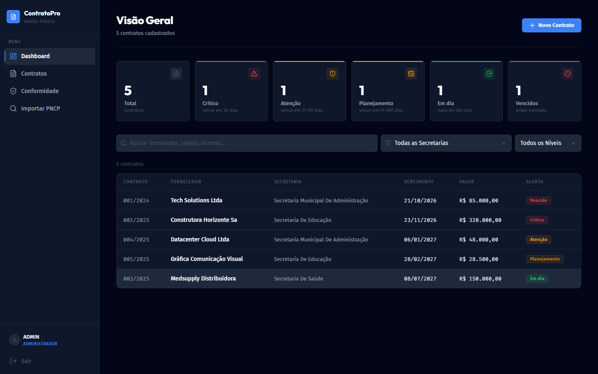
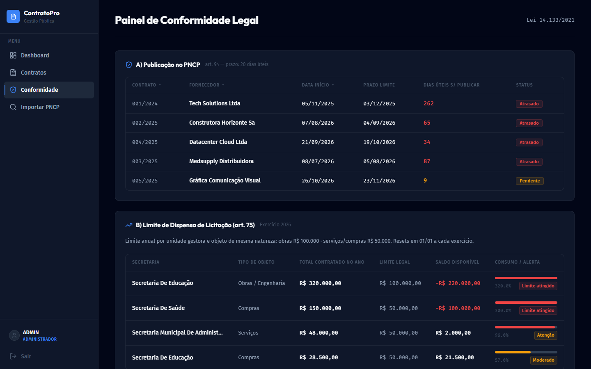

# ContratoPro

Sistema web para acompanhar contratos públicos municipais. Importa contratos do PNCP, mostra o que vence em breve e confere prazos e limites da Lei 14.133/2021.



*Tela do modo demonstração, com dados fictícios.*

## O problema

Contrato que vence sem aditivo deixa a prefeitura com serviço parado ou em situação irregular. O controle costuma ficar em planilha, e o prazo só aparece quando já está em cima.

## O que faz

**Alertas por prazo.** Cada contrato recebe um nível pelo vencimento, com a próxima ação indicada.

| Nível | Prazo | Ação indicada |
| --- | --- | --- |
| Crítico | até 30 dias | Emitir termo aditivo (art. 106) |
| Atenção | 31 a 90 dias | Publicar edital e iniciar licitação |
| Planejamento | 91 a 180 dias | Planejar o novo processo licitatório |
| Em dia | mais de 180 dias | Nenhuma ação imediata |
| Vencido | prazo expirado | Regularizar |

**Importação do PNCP.** Descobre os órgãos do município pelo código do IBGE e depois busca os contratos de cada CNPJ, respeitando a janela máxima de 365 dias da API.

**Painel de conformidade.** Três blocos: publicação no PNCP (art. 94, 20 dias úteis), consumo do limite de dispensa por secretaria e tipo de objeto (art. 75) e calendário de licitações.

**Alertas no WhatsApp.** O fluxo [`n8n_workflow_alertas.json`](n8n_workflow_alertas.json) roda todo dia às 8h, busca os contratos que vencem em 7, 15 e 40 dias e avisa fiscal e secretário.

**Modo demonstração.** Roda sem banco, com dados fictícios no `localStorage`.



## Stack

React 19, TypeScript, Vite, React Router, Supabase (Postgres e Auth), n8n e Vercel. A Vercel faz o proxy das chamadas para a API do PNCP (`vercel.json`).

## Como rodar

Testado com Node 24.

```bash
npm install
npm run dev
```

Abra o endereço que o Vite mostrar e clique em **Entrar no Modo Demonstração (Local)**.

Para usar um banco próprio, rode `supabase_setup.sql` e `supabase_fix_import.sql` no Supabase e troque a URL e a chave em `src/lib/supabase.ts`.

## Limitações

- As políticas de RLS em `supabase_fix_import.sql` são abertas (`USING (true)`), feitas para o MVP. Antes de usar com dados reais, é preciso restringir por usuário autenticado e por perfil. Hoje a separação entre administrador e usuário comum existe só na interface.
- Os limites de dispensa estão fixos no código (R$ 100 mil para obras, R$ 50 mil para o resto) e não acompanham a atualização anual por decreto.
- Não há testes automatizados no repositório.
- O lint ainda aponta erros, em boa parte por uso de `any`.
